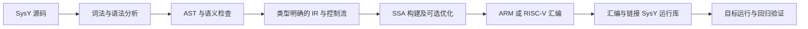

# 双人编译器开发计划

本文件是建议工程流程，不安排时间。先保障基础功能端到端可运行，再实现进阶功能。搭档为 `3769lkj`；A/B 的具体负责模块尚待双方认领。

## 里程碑

| 阶段 | A 主责 | B 主责 | 验收门槛 |
| --- | --- | --- | --- |
| M0 预备实验 | 工具链与 LLVM IR | 汇编、运行库、测试 | 三种实现等价，两人提交 PDF |
| M1 前端 | Token、词法、Parser、AST | 构建体系、测试、符号表和诊断 | 基础语法形成 AST，错误定位含行列 |
| M2 语义与 IR | 类型检查、作用域、常量求值 | IR、基本块、控制流、运行时接口 | int/函数/条件/循环的 IR 正确；短路成立 |
| M3 基础后端 | 调用与局部对象布局，支持联调 | 目标指令、寄存器/栈、汇编输出与链接 | 全部基础功能在目标平台通过回归 |
| M4 进阶 | 数组/float 前端和转换 | 数组/float 后端、mem2reg 与优化 | 功能两端完整，优化前后语义一致 |
| M5 交付 | 子集、正则、CFG 和设计材料 | 干净环境构建、测试与答辩演示 | 两人掌握全链路，交付源码可复现 |

每阶段包含联调和修复，通过验收后推进。资源不足时压缩可选功能并保留 M3/M5；不在基础回归未通过时继续堆优化。阶段不可仅凭负责人声明完成，以验收证据为准。

## 编译流程

## 接口先行

在双方并行开发前，用一份接口文档确认：Token 行列信息、AST 所有权、类型表示、作用域查找、诊断返回方式、IR 操作和 terminator、函数调用约定、输出路径。IR 必须允许 if/while 的控制流和 SSA；数组/float 不应留到最后才讨论表示方式。

工程建议：C++17 + CMake；Lexer/Parser 是否用 flex/bison 由双方决定，课程鼓励辅助工具但不强制。使用 LLVM 自带 IR/后端还是自研 IR/后端会影响课程模块工作量与评分，先向助教确认；不能以直接调用现成后端替代未经认可的目标代码生成模块。

从最小合法程序建立竖向流程，随后依次加入局部变量、表达式、if、while、函数、运行库。尽早完成目标架构上的链接运行，避免后期才暴露 ABI 不匹配。

## 测试组织

| 测试层 | 覆盖 | 主要证据 |
| --- | --- | --- |
| 前端 | 进制常量、注释、优先级、`++a`、语法错误 | Token/AST、行列诊断 |
| 语义 | const 写入、未定义名字、重复定义、参数类型、作用域 | 正确拒绝或正确绑定 |
| 控制流 | if/else、短路、循环、break/continue、返回 | 输出与预期一致，IR 控制流合法 |
| 后端 | 参数、返回、寄存器保存、栈对齐、递归、运行库 | 目标程序运行和退出码 |
| 进阶 | 多维数组、部分初始化、float、隐式转换 | 特性完整覆盖前端到后端 |
| 优化 | mem2reg、不可达块、无用语句及任选两项 | 优化前后输出一致，IR 结构变化符合预期 |

性能测试只在正确性通过后执行，固定输入、工具版本和目标环境；不能把程序变错或删掉可观测副作用造成的加速作为优化成绩。

## 任务清单

建议按以下标题创建 GitHub Issues，逐项带验收证据，当前尚未创建远程 Issues：

1. M0：组队备案、目标架构与运行库确认。
2. M0：预备工具链观察、手写 IR/汇编和报告。
3. M1：构建入口、Token/AST 接口与基础词法语法。
4. M2：符号表、类型检查、基础 IR 和短路控制流。
5. M3：目标后端、运行库链接与基础集成测试。
6. M4：数组和浮点端到端支持；确认张量要求。
7. M4：完整 mem2reg、不可达块和无用语句删除。
8. M4：选择并实现两项进阶优化。
9. M5：子集/正则/CFG 文档、交付检查和双人答辩。
